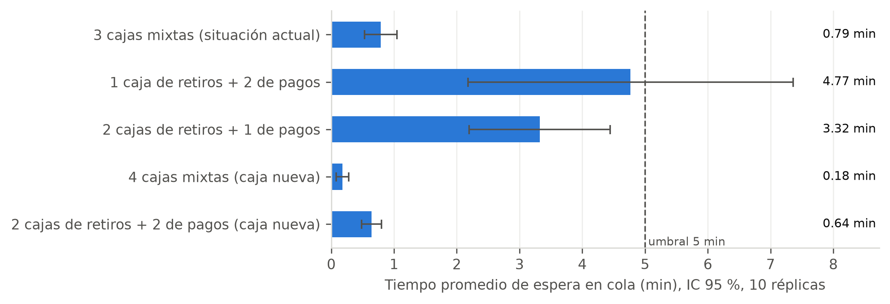

# Actividad 3: Simulación de las cajas del Banco de Colombia

Simulación de eventos discretos (SimPy) de una jornada de 8 horas en un banco con cajas atendidas por personas. Cada caja es una cola M/M/1 independiente. Se compara la situación actual (3 cajas mixtas) con las dos asignaciones exclusivas que plantea el banco (1 retiros + 2 pagos y 2 retiros + 1 pagos) y con dos configuraciones de 4 cajas.

## Video de sustentación

- [Ver en Google Drive](https://drive.google.com/file/d/1RrOLuLS9ZB8xhWtQjGjNhvygpks3HRGs/view?usp=sharing)
- Copia en el repositorio: [`video/sustentacion_actividad3.mp4`](video/sustentacion_actividad3.mp4)

## El modelo

- Llegadas por una sola puerta: 70 % retiros, 30 % pagos; tipo de usuario según la Tabla 2 del enunciado; tiempo entre llegadas y tiempo de servicio exponenciales con las medias de la Tabla 1 según el tipo.
- El usuario se forma en la caja habilitada para su operación que tenga menos personas (empates al azar) y no cambia de fila.
- Puertas abiertas de 0 a 480 min; quien ya está adentro al cierre es atendido.
- 10 réplicas por escenario (semilla = número de réplica, la misma en todos los escenarios: números aleatorios comunes) y 100 réplicas de confirmación (semillas 1001 a 1100).

| Escenario | Cajas |
|---|---|
| E0_3mixtas | 3 mixtas (actual) |
| E1_1R_2P | 1 retiros + 2 pagos |
| E2_2R_1P | 2 retiros + 1 pagos |
| E3_4mixtas | 4 mixtas |
| E4_2R_2P | 2 retiros + 2 pagos |

## Resultados principales

Espera promedio en fila (minutos), media de 10 réplicas con IC 95 %:

| Escenario | General | Retiros | Pagos |
|---|---|---|---|
| E0: 3 mixtas (actual) | 0,79 [0,53; 1,05] | 0,85 | 0,67 |
| E1: 1 retiros + 2 pagos | 4,77 [2,18; 7,36] | 6,48 | 0,89 |
| E2: 2 retiros + 1 pagos | 3,32 [2,20; 4,44] | 0,60 | 9,50 |
| E3: 4 mixtas | 0,18 [0,08; 0,28] | 0,18 | 0,17 |
| E4: 2 retiros + 2 pagos | 0,64 [0,48; 0,80] | 0,55 | 0,85 |

1. **Tiempo de atención por caja:** con 3 cajas mixtas, la caja 2 tiene el mayor (3,23 min) y la caja 3 el menor (3,18 min), una diferencia no significativa. Al especializar, la caja de pagos es la más lenta (hasta 5,33 min) y la de retiros la más rápida (2,30 min).
2. **Usuarios por tipo:** 214,4 usuarios por día en promedio. Retiro Normal es el tipo más frecuente (62,6) y Pago Rápido el menos frecuente (6,8).
3. **Usuarios por réplica:** la réplica 4 tiene el menor total (189) y la 7 el mayor (242). La tabla completa está en `data/usuarios_tipo_replica.csv`.
4. **¿Caja nueva?** No hace falta con las cajas mixtas: ningún criterio de espera pasa de 5 min. Sí hace falta si se especializan las cajas.
5. **Asignación:** 2 cajas de retiros y 1 de pagos, que da 1,90 min menos de espera que la opción contraria (100 réplicas, p < 0,001). La recomendación final es mantener las 3 cajas mixtas.

**Réplicas necesarias** (IC 95 % con ±0,5 min de precisión): entre 3 y 9 para E0, E3 y E4; entre 72 y 599 para E1 y E2. Por eso se agregaron 100 réplicas de confirmación. Detalle en `data/replicas_necesarias.csv`.

Evidencias:

- Figuras en [`figures/`](figures/).
- Datos en [`data/`](data/), con el libro [`resultados_simulacion_banco.xlsx`](data/resultados_simulacion_banco.xlsx).
- Informe en [`informe/Valencia_Santiago_problemaBancario.pdf`](informe/Valencia_Santiago_problemaBancario.pdf).



## Cómo reproducir

Desde esta carpeta (`Actividad 3/`), con [uv](https://docs.astral.sh/uv/):

```bash
uv venv --python 3.12 .venv
uv pip install --python .venv/Scripts/python.exe -r requirements.txt   # Windows
# Linux/macOS: uv pip install --python .venv/bin/python -r requirements.txt

python demo.py             # demostración: responde los 5 puntos en consola (segundos)
python run_experiments.py   # escribe los CSV en data/
python make_figures.py      # escribe las figuras en figures/
python -m pytest -q         # pruebas
cd informe && npm install && node build_informe.js   # genera informe.docx
```

(Use el `python` del entorno virtual: `.venv\Scripts\python` en Windows o `.venv/bin/python` en Linux/macOS.)

## Contenido

```text
Actividad 3/
├── banco.py               # Modelo SimPy: parámetros, escenarios, lógica de las cajas
├── demo.py                # Demostración en consola de los 5 puntos
├── run_experiments.py     # Réplicas -> data/*.csv
├── make_figures.py        # Figuras -> figures/*.png
├── test_banco.py          # Pruebas
├── data/                  # Resultados (registros por usuario, resúmenes, comparaciones)
├── figures/               # Figuras del informe
├── informe/               # Generador del informe (docx-js) y el documento en Word y PDF
└── video/                 # Video de sustentación (copia comprimida)
```
