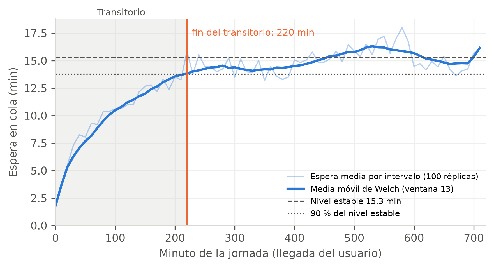
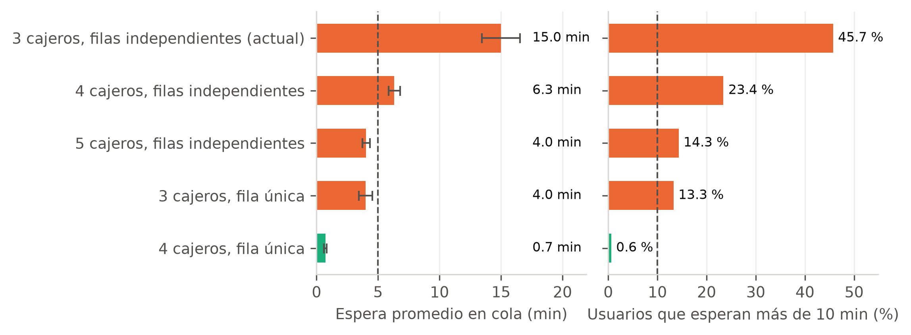

# Módulo 4, Actividad didáctica 2: problema de parqueaderos

Simulación de eventos discretos (SimPy) de los cajeros de autopago del parqueadero del centro comercial Supercentro. Cada cajero tiene su propia fila (cola M/M/1), sin cambio de fila ni deserción. La pregunta es si bastan los 3 cajeros actuales o si hay que instalar más.

## Video de sustentación

- Enlace: _pendiente_

## El modelo

- Cuatro tipos de usuario con tiempo de uso y tiempo entre llegadas exponenciales (medias del enunciado): rápido 1/3 min, normal 3/3 min, lento 4/5 min y muy lento 6/7 min.
- Proporciones: 25 % rápidos, 20 % normales y el 55 % restante lentos o muy lentos. Supuesto: 27,5 % cada uno, porque el enunciado no los separa. Hay un análisis de sensibilidad a ese reparto.
- Cada uno de los 3 cajeros actuales genera un flujo de llegadas con esas medias. El usuario elige una fila al azar y no cambia. Jornada de 12 horas (720 min).
- Escenarios: 3, 4 y 5 cajeros con filas independientes, y 3 y 4 cajeros con fila única. Todos usan los mismos usuarios (números aleatorios comunes).

## Estado estable y número de corridas

- **Transitorio (método de Welch):** 100 réplicas piloto. La variable es la espera media por intervalo de 10 min, suavizada con una media móvil de 13 puntos. El algoritmo toma como nivel estable la media de la segunda mitad (15,3 min) y marca el fin del transitorio en el primer intervalo donde la media móvil alcanza el 90 % de ese nivel: **220 min**.
- **Número de réplicas (media acumulada):** la media acumulada de la espera se queda dentro de ±5 % de su valor final desde **n = 56**. La fórmula del IC 95 % (t·s/√n ≤ 10 % de la media) pide **n = 70**. Se usan **70 réplicas** por escenario.
- **Eliminación del transitorio:** se descartan los usuarios que llegan antes del minuto 220. La espera media de la corrida piloto pasa de 14,0 min con transitorio a 15,5 min sin él. El dato con transitorio subestima la espera real.



## Resultados (70 réplicas, sin transitorio)

1. **Tiempo de atención por cajero:**
   - El cajero 1 tiene el menor tiempo (3,57 min) y el cajero 3 el mayor (3,64 min); el cajero 2 está prácticamente igual (3,64).
   - La diferencia no es significativa (ANOVA, p = 0,59), porque todos los cajeros reciben la misma mezcla de usuarios.
2. **Usuarios de cada tipo** (promedio por réplica en el estado estable, total de los 3 cajeros):

   | Rápido | Normal | Lento | Muy lento | Total |
   |---|---|---|---|---|
   | 81,3 | 63,3 | 88,6 | 87,9 | 321,1 |

3. **¿Bastan 3 cajeros?** Criterio de decisión: espera promedio ≤ 5 min **y** como máximo el 10 % de los usuarios esperando más de 10 min, con el menor número de cajeros posible.

   | Escenario | Espera (min) | % espera > 10 min | Utilización | ¿Cumple? |
   |---|---|---|---|---|
   | 3 cajeros, filas independientes (actual) | 15,0 | 45,7 % | 0,75 | No |
   | 4 cajeros, filas independientes | 6,3 | 23,4 % | 0,57 | No |
   | 5 cajeros, filas independientes | 4,0 | 14,3 % | 0,46 | No |
   | 3 cajeros, fila única | 4,0 | 13,3 % | 0,76 | No |
   | 4 cajeros, fila única | 0,7 | 0,6 % | 0,58 | **Sí** |

   **No bastan.** La estrategia propuesta tiene dos etapas:
   - **Etapa 1, sin inversión:** organizar una fila única para los 3 cajeros. La espera baja de 15 a 4 min.
   - **Etapa 2:** instalar un 4.º cajero con fila única, la única configuración que cumple todo el criterio.

   Una fila única con 3 cajeros rinde lo mismo que 5 cajeros con filas separadas (diferencia de 0,03 min, p = 0,86).
4. **Verificación, calibración y validación:**
   - **Verificación:** 16 pruebas automáticas.
   - **Calibración:** medias y proporciones simuladas contra la tabla.
   - **Validación:** espera simulada de 15,0 min, frente a 15,6 por Pollaczek-Khinchine y 17,2 por Kingman; utilización de 0,75 frente a ρ = 0,77.
   - El proceso está en la figura 7.
5. **Transitorio:** el algoritmo y la gráfica antes/después están en la figura 3 y en `run_experiments.py`.

Evidencias:

- Figuras en [`figures/`](figures/).
- Datos en [`data/`](data/), con el libro [`resultados_simulacion_parqueadero.xlsx`](data/resultados_simulacion_parqueadero.xlsx).
- Informe en [`informe/Valencia_Santiago_problemaParqueadero.pdf`](informe/Valencia_Santiago_problemaParqueadero.pdf).



## Cómo reproducir

Desde esta carpeta, con [uv](https://docs.astral.sh/uv/):

```bash
uv venv --python 3.12 .venv
uv pip install --python .venv/Scripts/python.exe -r requirements.txt   # Windows
# Linux/macOS: uv pip install --python .venv/bin/python -r requirements.txt

python demo.py              # demostración en consola de los puntos (unos 30 s)
python run_experiments.py   # piloto, estado estable y escenarios -> data/ (unos 50 s)
python make_figures.py      # figuras -> figures/
python -m pytest -q         # pruebas de verificación
cd informe && npm install && node build_informe.js   # genera el informe .docx
```

(Use el `python` del entorno virtual: `.venv\Scripts\python` en Windows o `.venv/bin/python` en Linux/macOS.)

## Contenido

```text
├── parqueadero.py         # Modelo SimPy: tabla de usuarios, escenarios, cajeros
├── run_experiments.py     # Welch, media acumulada, réplicas, escenarios -> data/
├── make_figures.py        # Figuras con Matplotlib -> figures/
├── demo.py                # Demostración en consola
├── test_parqueadero.py    # Pruebas de verificación
├── data/                  # Resultados en CSV y libro de Excel
├── figures/               # Figuras del informe
└── informe/               # Generador del informe (docx-js) y el documento en Word y PDF
```
